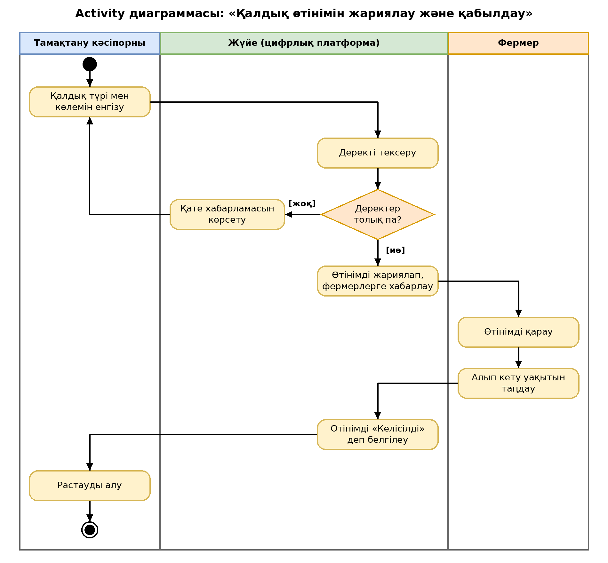
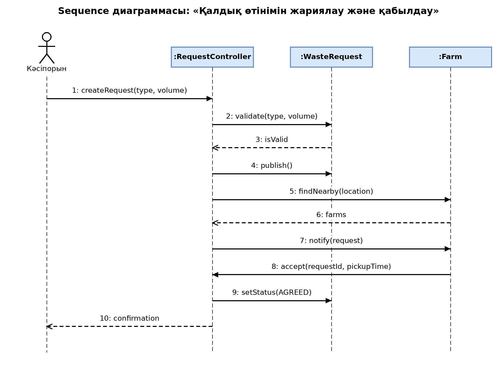

# Органикалық қалдықтарды ұтымды пайдалану мақсатында қоғамдық тамақтану кәсіпорындары мен фермерлік шаруашылықтардың өзара іс-қимылына арналған цифрлық платформа

Автор: [Аты Тегі], [топ]

## Мәселе
Қоғамдық тамақтану кәсіпорындарында күн сайын көп органикалық қалдық (тамақ қалдықтары, көкөніс және жеміс қалдықтары) пайда болады, ал оларды пайдалана алатын фермерлік шаруашылықтармен тікелей байланыс жоқ.
Сондықтан қалдықтың көп бөлігі қоқысқа кетеді, фермерлер жемшөп пен органикалық тыңайтқыш көзін таба алмайды.
Платформа екі жақты біріктіріп, қалдықты беру мен алып кетуді цифрлық түрде ұйымдастырады.

## Акторлар
- Қоғамдық тамақтану кәсіпорны
- Фермер (фермерлік шаруашылық)
- Платформа әкімшісі

## Талаптар
### Функционалдық
1. Жүйе кәсіпорынға қалдық түрі мен көлемін көрсетіп, өтінім жариялауға мүмкіндік беруі керек.
2. Жүйе енгізілген деректің толықтығын тексеруі керек.
3. Жүйе жақын орналасқан фермерлерге жаңа өтінім туралы хабарлауы керек.
4. Жүйе фермерге өтінімді қарап, қабылдауға және алып кету уақытын таңдауға мүмкіндік беруі керек.
5. Жүйе кәсіпорынға өтінім келісілгені туралы растау жіберуі керек.

### Функционалдық емес
1. Платформа мобильді құрылғының браузерінде жұмыс істеуі керек.
2. Пайдаланушылардың деректері қорғалуы және рөлдер бойынша бөлінуі керек.

## Диаграммалар
### 1. Use Case
_(кейін қосылады)_

### 2. Class
_(кейін қосылады)_

### 3. Activity: Қалдық өтінімін жариялау және қабылдау

### 4. Sequence: Қалдық өтінімін жариялау және қабылдау

